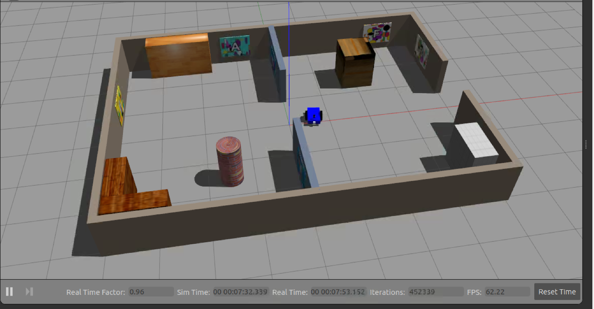
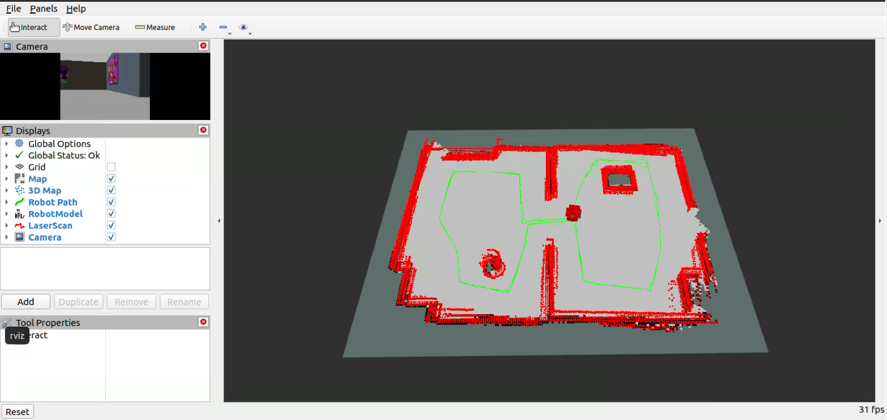
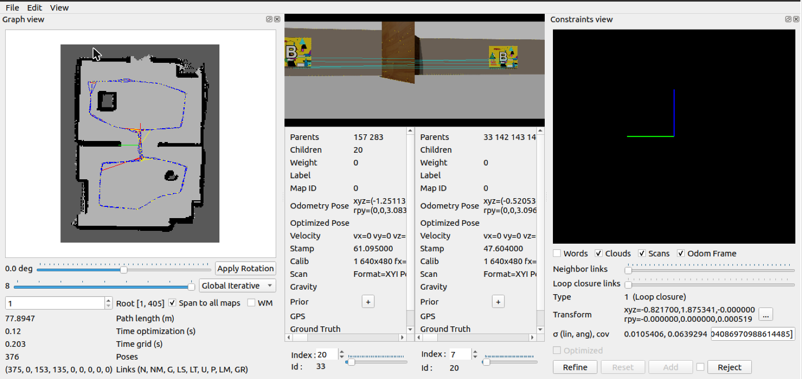
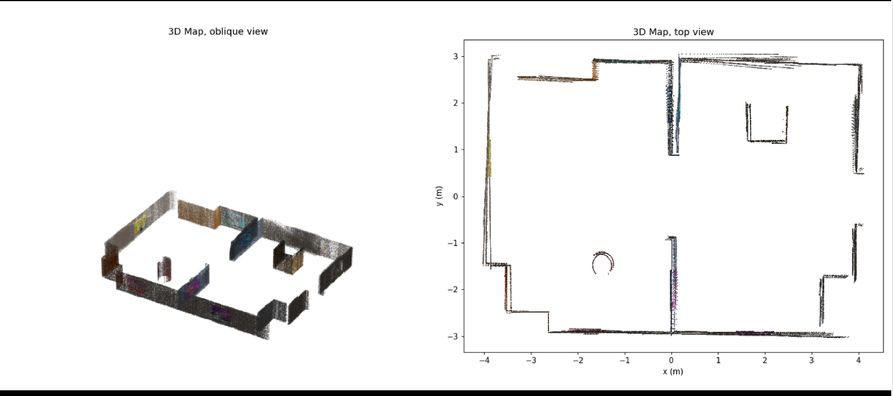

# Map My World

Udacity Robotics Software Engineer, project 4. The differential-drive robot from [Where Am I?](https://github.com/SebAustin/where-am-i) gets an RGB-D camera and builds its own Map (2D occupancy grid) and 3D Map of its building with RTAB-Map, while you drive it by keyboard. Vocabulary is in [GLOSSARY.md](GLOSSARY.md).

```
catkin_ws/src/
├── my_robot/
│   ├── launch/        world.launch (Gazebo + RViz), mapping.launch, localization.launch, teleop.launch
│   ├── meshes/        hokuyo.dae
│   ├── models/        landmarks: poster textures + OGRE material script (model://landmarks)
│   ├── rviz/          mapping.rviz
│   ├── scripts/       make_landmarks.py (poster textures), drive_route.py (scripted laps),
│   │                  render_cloud.py (3D Map picture from an exported cloud)
│   ├── test/          pytest: launch/robot/World wiring, the three scripts
│   ├── urdf/          my_robot.xacro, my_robot.gazebo
│   └── worlds/        sebastien.world: two rooms, Furniture and Landmarks
└── teleop_twist_keyboard/   vendored from ros-teleop
docs/screenshots/      Gazebo, RViz, database viewer and 3D Map from the graded Mapping Run
database/rtabmap.db    the graded Mapping Run's Database (Git LFS)
check_package.sh       static checks (no Gazebo needed)
```

## The World and its Landmarks

The building is the one from Where Am I?: two 4 × 6 m rooms joined by a 1.8 m doorway, with an opening in the east wall and full-height Furniture that breaks the layout's mirror symmetry for the lidar.

RTAB-Map needs more than geometry. It closes loops by recognising places in camera images, and grey walls give it nothing to recognise. So the World now carries Landmarks:

- **Textured Furniture.** Each piece wears a different built-in Gazebo texture: bookshelf `Wood`, pillar `Bricks`, L-counter `WoodFloor`, crate `WoodPallet`, cabinet `CeilingTiled`. These ship with Gazebo, so no download is needed.
- **Ten posters (A–J), one per wall section.** Each is a seeded random collage of high-contrast shapes under a large letter, so every poster gives the feature detector many corners and no two look alike. They are 0.8 × 0.6 m, centred 0.5 m up, which is in view of a camera mounted 0.12 m off the floor.

| Room | Posters |
|---|---|
| West | A north wall, B west wall, C south wall, D and E on the middle wall either side of the doorway |
| East | F north wall, G east wall, H south wall, I and J on the middle wall either side of the doorway |

The posters are visual only (no collision), so the lidar, and therefore the Map, sees bare walls. The walls themselves stay plain on purpose. A repeating brick texture on every wall would make different places look alike to the camera and invite false Loop Closures.

The textures live in `models/landmarks/` and reach Gazebo through the `gazebo_model_path` export in `package.xml`. To change a poster, edit `scripts/make_landmarks.py` and run:

```bash
cd catkin_ws/src/my_robot
python3 scripts/make_landmarks.py models/landmarks   # needs Pillow
```

## Robot changes from Where Am I?

- **Camera → simulated Kinect.** `libgazebo_ros_camera.so` is replaced by `libgazebo_ros_openni_kinect.so` (640 × 480, 60° field of view, 0.1–20 m). It publishes `/camera/rgb/image_raw`, `/camera/depth/image_raw`, `/camera/rgb/camera_info` and `/camera/depth/points`.
- **`camera` link renamed `camera_link`**, plus a `camera_link_optical` child rotated (−90°, 0, −90°). Images are published in that optical frame (z forward, x right, y down), so the 3D Map lands the right way up.
- **Unchanged:** the 270° lidar on `/scan`, the base link `robot_footprint`, the Start Pose at the middle doorway facing east, and ground-truth odometry (`odometrySource` = `world`).

## Setup (Udacity VM, ROS Noetic)

The current Noetic package is RTAB-Map 0.21, which moved the nodes out of `rtabmap_ros`: the course template's `rtabmap_ros/rtabmap` is now `rtabmap_slam/rtabmap`, and `rtabmapviz` is `rtabmap_viz/rtabmap_viz`. The launch files here use the new names.

```bash
sudo apt-get update
sudo apt-get install -y ros-noetic-rtabmap-ros xterm
git clone https://github.com/SebAustin/map-my-world.git ~/map-my-world
cd ~/map-my-world/catkin_ws && catkin_make && source devel/setup.bash
~/map-my-world/check_package.sh
```

If `apt-get update` fails with `EXPKEYSIG F42ED6FBAB17C654`, the VM's ROS signing key has expired. Refresh it and retry:

```bash
sudo curl -sSL https://raw.githubusercontent.com/ros/rosdistro/master/ros.key -o /usr/share/keyrings/ros-archive-keyring.gpg
echo 'deb [signed-by=/usr/share/keyrings/ros-archive-keyring.gpg] http://packages.ros.org/ros/ubuntu focal main' | sudo tee /etc/apt/sources.list.d/ros-latest.list
```

## A Mapping Run

Three terminals, each with `source ~/map-my-world/catkin_ws/devel/setup.bash`:

```bash
roslaunch my_robot world.launch      # 1: Gazebo + RViz
roslaunch my_robot teleop.launch     # 2: opens an xterm; click it and drive
roslaunch my_robot mapping.launch    # 3: RTAB-Map; add rtabmapviz:=true for its GUI
```

The teleop window takes `i` (forward), `j`/`l` (turn), `k` (stop), and `q`/`z` to speed up or slow down. It starts at 0.3 m/s. Over a remote desktop, where keys arrive as single taps, use `roslaunch my_robot teleop.launch key_timeout:=600` so each key keeps the robot moving until the next one.

In RViz the Map (grey), the 3D Map (coloured points) and the Robot Path (green) grow as you drive.

**Route.** Loop Closures come from seeing the same Landmark again from about the same viewpoint, so repeat one route rather than wandering:

1. From the doorway, turn into the west room and drive a slow clockwise lap about 1 m off the walls, past posters D, A, B, C and E and around the pillar.
2. Back through the doorway, do the same clockwise lap of the east room past I, F, G, H and J.
3. Repeat both laps twice more. Turn slowly: fast turns blur the image and lose features.

Three laps usually give well over the required three Loop Closures. To watch them arrive, run `rostopic echo /rtabmap/info/loopClosureId` in a fourth terminal: any value above 0 is a Loop Closure.

**Scripted laps.** Over a remote desktop, where held keys don't come through, the same route can be driven automatically. It publishes the same `/cmd_vel` as teleop and steers by `/odom` from waypoint to waypoint, about 2 minutes per lap:

```bash
rosrun my_robot drive_route.py _laps:=3    # instead of teleop.launch
```

**Stopping.** Press Ctrl+C in terminal 3. The Database is written to `~/.ros/rtabmap.db`. Copy it away before the next run, because `mapping.launch` deletes it on startup:

```bash
cp ~/.ros/rtabmap.db ~/rtabmap_$(date +%H%M).db
```

## Checking the Database

```bash
rtabmap-databaseViewer ~/.ros/rtabmap.db
```

Answer **yes** to using the Database's parameters, then open **View → Constraints view** and **View → Graph view**. The line under the graph reads `Links (N, NM, G, LS, LT, U, P, LM, GR)`. The rubric needs **G (global Loop Closures) ≥ 3**. To see the 3D Map, use **Edit → View 3D map**.

Over a remote desktop the 3D viewer can't be zoomed (wheel events don't come through). Export the cloud and draw it instead:

```bash
rtabmap-export --output_dir ~/export --output map --voxel 0.02 ~/.ros/rtabmap.db
python3 catkin_ws/src/my_robot/scripts/render_cloud.py ~/export/map_cloud.ply ~/export/3d_map.png
```

If a run ends with fewer than three Loop Closures, lower `Vis/MinInliers` from 15 to 12 in `mapping.launch` and drive the laps again. If the Map shows doubled walls after a Loop Closure, try `Reg/Strategy` 2 (visual then ICP refinement with the lidar).

## Localization on a finished Database

```bash
roslaunch my_robot world.launch
roslaunch my_robot localization.launch database_path:=$HOME/rtabmap_1234.db
```

`localization.launch` is `mapping.launch` with three changes: it keeps the Database instead of deleting it, it drops `Mem/NotLinkedNodesKept`, and it sets `Mem/IncrementalMemory=false` so RTAB-Map only localizes against the Map and never extends it. The robot's pose on the Map appears once it passes a Landmark it recognises.

## RTAB-Map parameters (`launch/mapping.launch`)

| Parameter | Value | Why |
|---|---|---|
| `frame_id` | `robot_footprint` | This robot's base link (the course template says `base_footprint`, which this robot doesn't have) |
| `odom_frame_id` | `odom` | Published by the diff-drive plugin |
| `subscribe_depth` / `subscribe_scan` | true / true | RGB-D camera plus the 270° lidar |
| `Grid/Sensor` | 0 (laser) | Map from the lidar: sharp walls, no gaps. The camera builds the 3D Map. Called `Grid/FromDepth` before 0.21 |
| `Rtabmap/DetectionRate` | 1 Hz | One new node per second, as in the template |
| `Reg/Force3DoF` | true | The robot drives on a flat floor: x, y, yaw only |
| `Kp/DetectorStrategy`, `Vis/FeatureType` | 8 (GFTT/ORB) | Always built in. The template's SURF is in OpenCV's nonfree module, which apt builds usually omit |
| `Kp/MaxFeatures` | 400 | Visual words per image, as in the template |
| `Reg/Strategy` | 0 (visual) | As in the template; 2 is the documented fallback |
| `Vis/MinInliers` | 15 | Matches needed to accept a Loop Closure; 12 if a run falls short |
| `Mem/NotLinkedNodesKept` | false | Don't store images while the robot stands still |

Because odometry is Gazebo's ground truth, the robot's path doesn't drift. Loop Closures here mainly prove that the camera recognises the building, which is what the rubric measures.

## Database

The Database from the graded Mapping Run is [`database/rtabmap.db`](database/rtabmap.db) (178 MB). It is over GitHub's 100 MB file limit, so it is stored with [Git LFS](https://git-lfs.com). A plain clone gets a small pointer file in its place; fetch the real file with:

```bash
sudo apt-get install -y git-lfs && git lfs install
git lfs pull
rtabmap-databaseViewer database/rtabmap.db
```

It can also be downloaded directly from GitHub: open the file above and click **Download raw file**.

## Results

One Mapping Run on the Udacity VM (Noetic, RTAB-Map 0.21.13, Gazebo real-time factor 0.95–1.0): three laps of the route above with `drive_route.py`, 7 minutes of simulated time.

| Measure | Value |
|---|---|
| Poses (nodes) | 376 |
| Path length | 77.9 m |
| **Global Loop Closures (G)** | **153** (rubric: ≥ 3) |
| Local Loop Closures by space (LS) | 135 |
| Neighbour links (N) | 375 |
| Database size | 178 MB |
| `localization.launch` on a copy of the Database | no errors; 42 of 55 updates during part of a lap matched the Database |

The first two Loop Closures were already accepted within the first 45 nodes, during lap 1. Candidates with too few matching features were rejected (for example 0/15 inliers), as `Vis/MinInliers` intends. With ground-truth odometry the path never drifts, so the Loop Closures don't visibly move the Map: walls stay single, and the Map and 3D Map line up with the World's walls (x = ±4 m, y = ±3 m, the middle wall at x = 0) in the top view below.

**1. The World in Gazebo**: textured Furniture and the posters, with the robot back at the doorway after the run.


**2. RViz at the end of the run**: the Map built from the lidar, the Robot Path (green) over three laps, and the camera view (top left) facing a poster.


**3. rtabmap-databaseViewer**: the Graph view (left) with the Map and the robot's path, and a Loop Closure between two sightings of poster B (middle; cyan lines join the matching features). The counters bottom left read `375, 0, 153, 135, …` for N, NM, G, LS.


**4. The 3D Map** from the RGB-D camera (floor removed, exported with `rtabmap-export` and drawn with `render_cloud.py`). The walls, doorway, crate, pillar, cabinet and L-counter sit where they are in the World, coloured by the camera, with the posters visible on the walls.


## Checks

```bash
./check_package.sh
```

This checks that the XML is well formed, then runs the pytest suite: RTAB-Map's remapped topics match what the Gazebo plugins publish, `frame_id` and `odom_frame_id` match the URDF and diff drive, the optical frame is wired as the brief specifies, `localization.launch` differs from `mapping.launch` exactly as the brief says, and every poster has its material and texture. On the VM, after `catkin_make`, it also resolves all four launch files with `roslaunch --files` and confirms the `rtabmap_slam/rtabmap` and `rtabmap_viz/rtabmap_viz` executables exist (RTAB-Map 0.21+ moved them out of `rtabmap_ros`, so the course template's `rtabmap_ros/rtabmap` no longer launches).
