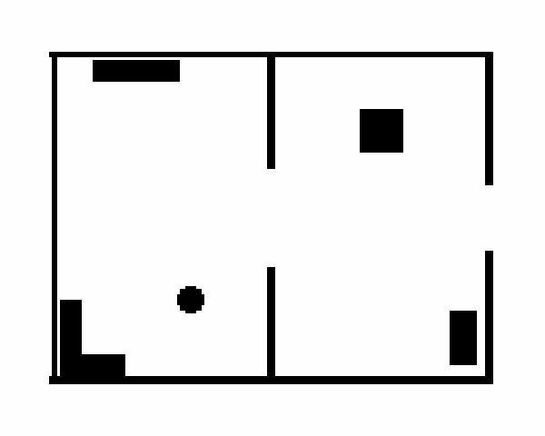
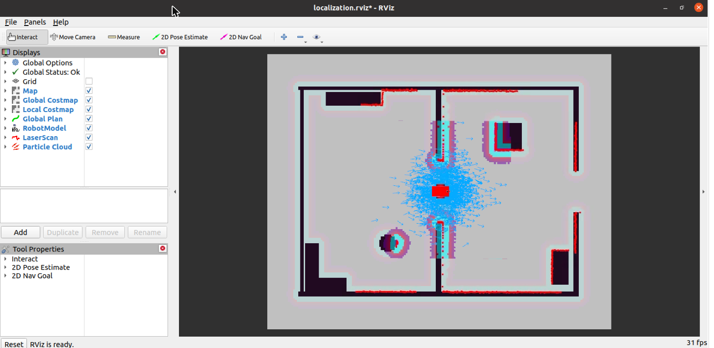
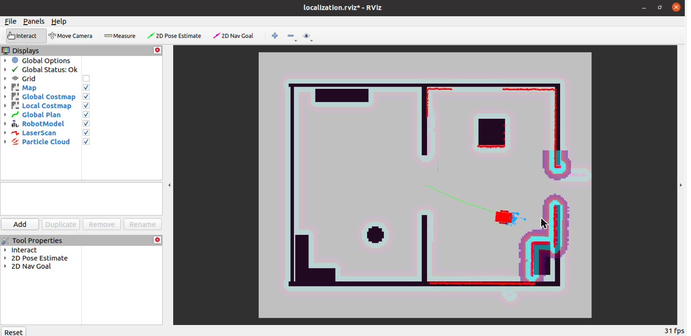
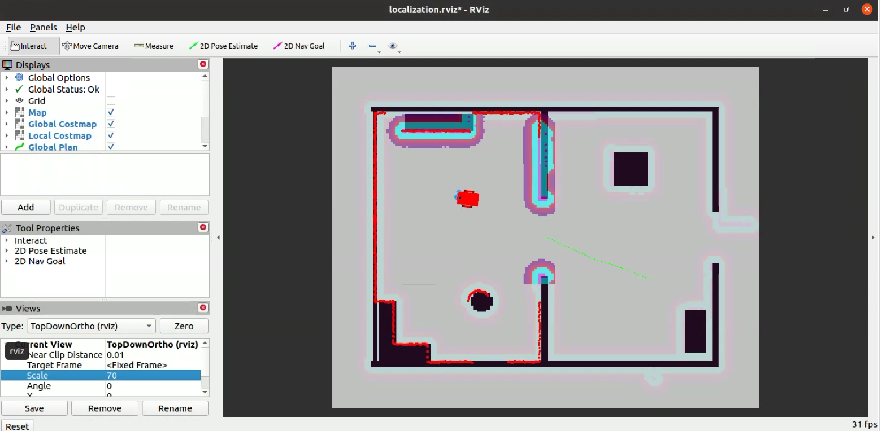
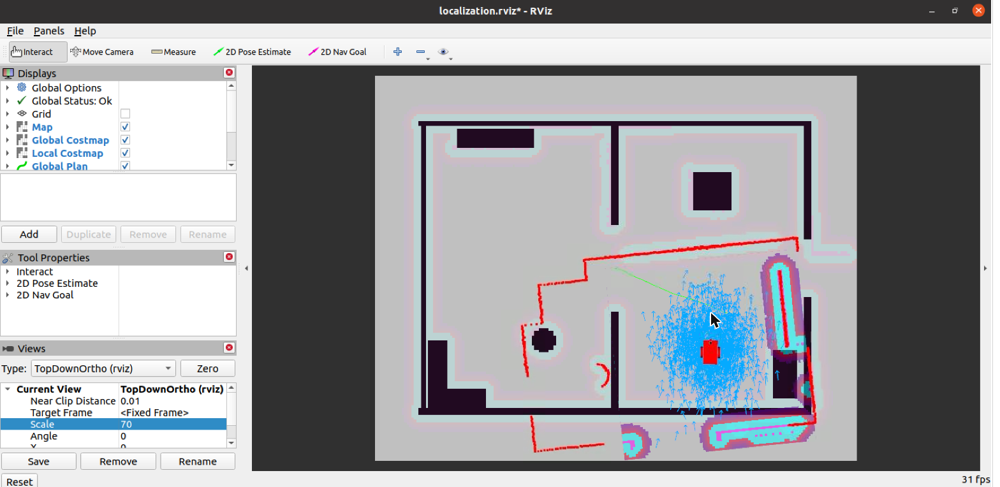
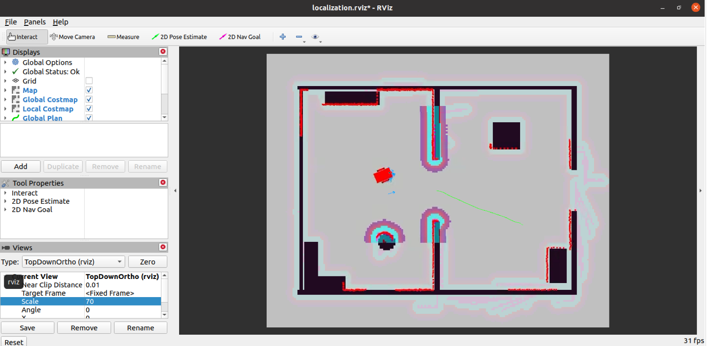

# Where Am I?

Udacity Robotics Software Engineer, project 3. The differential-drive robot from [Go Chase It](https://github.com/SebAustin/go-chase-it) finds and keeps track of its Pose Estimate on a known Map of its building, using AMCL on lidar and odometry. It can be driven by keyboard or sent Navigation Goals through `move_base`. Vocabulary is in [GLOSSARY.md](GLOSSARY.md).

```
catkin_ws/src/
├── my_robot/
│   ├── config/        move_base costmap and local planner parameters
│   ├── launch/        world.launch (Gazebo + RViz), amcl.launch (map_server, amcl, move_base)
│   ├── maps/          map.pgm + map.yaml, generated from the World
│   ├── meshes/        hokuyo.dae
│   ├── rviz/          localization.rviz
│   ├── scripts/       make_map.py (World -> Map)
│   ├── test/          pytest for make_map.py
│   ├── urdf/          my_robot.xacro, my_robot.gazebo
│   └── worlds/        sebastien.world: two rooms plus Furniture
└── teleop_twist_keyboard/   vendored from ros-teleop
docs/screenshots/      submission screenshots
check_package.sh       static checks (no Gazebo needed)
```

## The World and the Map

The building is two 4 × 6 m rooms joined by a 1.8 m doorway, with an opening in the east wall. On its own, that layout is mirror-symmetric: a robot in the west room facing east sees nearly the same scan as one in the east room facing west, so AMCL can split into two clusters. Six full-height pieces of Furniture break the symmetry:

| Room | Furniture | Position |
|---|---|---|
| West | bookshelf 1.6 × 0.4 m | north wall, (−2.5, 2.7) |
| West | pillar, r 0.25 m | (−1.5, −1.5) |
| West | L-shaped counter | SW corner |
| East | crate 0.8 × 0.8 m | (2.0, 1.6) |
| East | cabinet 0.5 × 1.0 m | (3.5, −2.2) |

The Map is generated from the World file by `scripts/make_map.py` instead of `pgm_map_creator`, which was written for Kinetic and needs CMake patches on Noetic. The script reads every box and cylinder collision that crosses the lidar's scan height (0.27 m), so the Map lines up with the Gazebo walls exactly. Output: 200 × 160 cells at 0.05 m, origin (−5, −4), covering the building with 1 m of margin.



Regenerate after editing the World:

```bash
cd catkin_ws/src/my_robot
python3 scripts/make_map.py worlds/sebastien.world maps/map
```

## Robot changes from Go Chase It

- Lidar widened from 180° to 270° (±2.356 rad, like a Hokuyo UTM-30LX), 720 samples on `/scan`. More walls per scan means faster convergence.
- Lidar raised 5 cm so its beams (0.27 m) clear the wheel tops (0.24 m); otherwise the rear of the wider scan would see the robot's own wheels.
- Start Pose moved to the middle doorway, (0, 0) facing east, which is also the AMCL initial pose.

## Setup (Udacity VM, ROS Noetic)

```bash
sudo apt-get update
sudo apt-get install -y ros-noetic-navigation ros-noetic-map-server ros-noetic-move-base ros-noetic-amcl
git clone https://github.com/SebAustin/where-am-i.git ~/where-am-i
cd ~/where-am-i/catkin_ws && catkin_make && source devel/setup.bash
```

If `apt-get update` fails with `EXPKEYSIG F42ED6FBAB17C654`, the VM's ROS signing key has expired. Refresh it and retry the install:

```bash
sudo curl -sSL https://raw.githubusercontent.com/ros/rosdistro/master/ros.key -o /usr/share/keyrings/ros-archive-keyring.gpg
echo 'deb [signed-by=/usr/share/keyrings/ros-archive-keyring.gpg] http://packages.ros.org/ros/ubuntu focal main' | sudo tee /etc/apt/sources.list.d/ros-latest.list
```

## Run

```bash
roslaunch my_robot world.launch    # terminal 1: Gazebo + RViz
roslaunch my_robot amcl.launch     # terminal 2: map_server, amcl, move_base
```

RViz opens in the `map` frame. It shows the Map, both costmaps, the lidar scan (red), the global plan (green) and the Particle Cloud (blue arrows). The map-dependent displays turn green once `amcl.launch` is up.

Drive the robot in either of two ways:

- **Navigation Goal:** click **2D Nav Goal** in RViz and drag on the Map. `move_base` plans and drives there.
- **Teleop:** in a third terminal, `rosrun teleop_twist_keyboard teleop_twist_keyboard.py` (`i` forward, `j`/`l` turn, `k` stop). Teleop stops the robot 0.5 s after the last keypress unless the key is held. Over a remote desktop, where keys arrive as single taps, add `_key_timeout:=600` so each key keeps the robot moving until the next one.

Teleop and `move_base` both publish `/cmd_vel`. Wait for a Navigation Goal to finish ("Goal reached") before driving by keyboard, or `move_base` overrides the keys.

**Kidnapped robot.** Use **2D Pose Estimate** to put the Pose Estimate somewhere wrong. In testing, AMCL did not recover on its own from a wrong guess in the other room: the rooms are similar enough that the wrong pose still scored reasonably, so the random-particle injection never triggered. Re-localizing from scratch does work: `rosservice call /global_localization` scatters particles over the whole Map, and a few metres of driving bring them back to a single cluster on the true pose (screenshots 4a and 4b).

## AMCL parameters (`launch/amcl.launch`)

| Parameter | Value | Why |
|---|---|---|
| `min_particles` / `max_particles` | 500 / 2500 | Enough to cover the start covariance; AMCL shrinks toward 500 once converged |
| `initial_pose_x/y/a` | 0, 0, 0 | The Start Pose |
| `initial_cov_xx/yy/aa` | 0.25, 0.25, 0.07 | 0.5 m and ~15° of starting doubt |
| `update_min_d` / `update_min_a` | 0.1 m / 0.2 rad | Frequent updates at the robot's ≤ 0.5 m/s |
| `transform_tolerance` | 0.5 | Avoids TF timeout warnings on the VM's slow sim clock |
| `recovery_alpha_slow/fast` | 0.001 / 0.1 | Injects random particles when the scan match suddenly gets worse (see *Kidnapped robot* for its limits) |
| `laser_model_type` | likelihood_field | Cheap and robust for walls and Furniture |
| `laser_max_beams` | 60 | Every 12th of the 720 beams, plenty for a small building |
| `laser_z_hit` / `laser_z_rand` | 0.95 / 0.05 | The simulated lidar is clean (σ 1 cm) |
| `laser_likelihood_max_dist` | 2.0 m | Distance over which the likelihood field is computed |
| `odom_model_type` | diff-corrected | Differential drive |
| `odom_alpha1..4` | 0.005 | Gazebo odometry is ground truth; diff-corrected expects small values (the 0.2 default is far too noisy) |

## move_base parameters (`config/`)

Based on Udacity's `config.zip`, retuned for this robot:

| Parameter | Value | Why |
|---|---|---|
| `footprint` | 0.5 × 0.3 m rectangle | The real chassis instead of a 0.3 m circle |
| layers | static, obstacle, inflation | Explicit `plugins` lists (local costmap: obstacle + inflation only) |
| `inflation_radius` | 0.35 m | Keeps clear of walls; the 1.8 m doorway stays passable |
| `obstacle_range` / `raytrace_range` | 2.5 / 3.0 m | Marks nearby obstacles and clears free space behind them |
| `observation_sources` topic | `/scan` | This robot's lidar topic |
| costmap update / publish | 5 / 2 Hz | Avoids "map update loop missed its desired rate" warnings |
| local costmap | 4 × 4 m rolling | Small and fast, built from live lidar only |
| `max_vel_x` / `max_vel_theta` | 0.5 m/s / 1.0 rad/s | Slow enough for AMCL to keep up |

## Stopping for obstacles

The local costmap is built only from the live lidar, so anything that appears in the robot's path gets marked within one scan. Try it: send a Navigation Goal across the building, then drop a box in front of the robot (Insert → Box in Gazebo, or `rosrun gazebo_ros spawn_model`). The box shows up in the costmaps, and the planner routes around the inflated cells. If no path exists, `move_base` runs its recovery behaviours (clear costmaps, rotate in place) and aborts the goal instead of driving into the box.

Tested on the VM: a 0.5 m box spawned at (1.3, −0.55), in the way of a goal at (2.5, −1.2). It appeared in the costmap, and the robot reached the goal without touching it.

## Results

Measured on the Udacity VM (Gazebo real-time factor 0.98–1.0). Ground truth is Gazebo's `/odom`, which is exact because `odometrySource` is `world`.

| Moment | AMCL pose (x, y, yaw) | Ground truth | Error | AMCL σ (x, y, yaw) |
|---|---|---|---|---|
| Just launched | 0.03, 0.01, — | 0, 0, 0° | 4 cm | initial 0.5 m, 15° |
| Navigation Goal reached, east room | 2.25, −0.91, 154° | 2.29, −0.85, 154° | 7 cm, 0° | 5 cm, 5 cm, 2.6° |
| Teleop through the doorway | 0.06, 0.64, 173° | 0.13, 0.64, 176° | 7 cm, 3° | 5 cm, 5 cm, 2.3° |
| Teleop into the west room | −1.81, 0.90, 172° | −1.75, 0.90, 172° | 6 cm, 0° | 5 cm, 6 cm, 1.9° |
| After global localization and a few metres of driving | −1.60, 0.43, 14° | −1.53, 0.42, 22° | 7 cm, 8° | 4 cm, 7 cm, 2.8° |
| Navigation Goal past a dropped box | 2.40, −1.11, −10° | 2.42, −1.08, −3° | 4 cm, 7° | 7 cm, 5 cm, 2.6° |

In RViz the converged cloud sits mostly under the robot model, so only a few arrows show at its nose. The cloud's mean matches the AMCL pose exactly.

## Screenshots

**1. Just launched:** the Particle Cloud is spread around the Start Pose, and the scan (red) already lines up with the walls.


**2. After a Navigation Goal into the east room:** the cloud has collapsed onto the robot, and the scan matches the walls, crate and cabinet.


**3. After teleop back into the west room:** still converged; the scan matches the bookshelf, pillar and counter.


**4a. Kidnapped:** a 2D Pose Estimate in the wrong room. The scan no longer matches the Map.


**4b. Recovered:** after `/global_localization` and some driving, the cloud is back on the true pose and the scan matches again.


## Checks

```bash
./check_package.sh
```

This checks that the XML is well formed, runs the map-generator tests (skipped if pytest is not installed), confirms that `map.pgm` is in sync with the World and matches `map.yaml`, and confirms that the Start Pose equals the AMCL initial pose. On the VM, after `catkin_make`, it also resolves both launch files with `roslaunch --files`.
